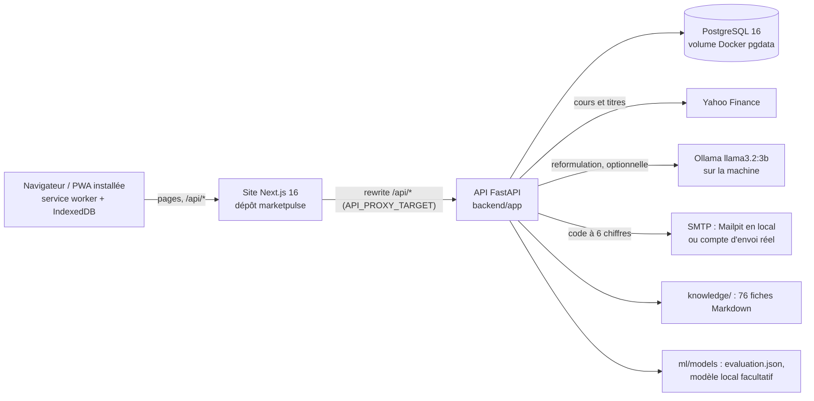

# MarketPulse — API (dépôt `finsight`)

[](https://github.com/yakin653/finsight/actions/workflows/ci.yml)

API FastAPI + PostgreSQL du site MarketPulse. Le site (Next.js, PWA) est dans le dépôt `marketpulse`.
Elle sert les cours (Yahoo Finance), les comptes et sessions, les alertes (CRUD), les notifications,
les 76 fiches de connaissance et le chat (réponse déterministe en Python, reformulée par Ollama si disponible).

## Démarrage en une page

Prérequis : Docker Desktop lancé, ports 8000 et 5432 libres. Optionnel : Ollama sur la machine avec `llama3.2:3b`.

```powershell
# depuis la racine du dépôt finsight
copy .env.example .env
docker compose up -d --build
```

- Santé de l'API : http://127.0.0.1:8000/health
- État complet (base, Ollama, âge des cours, modèle) : http://127.0.0.1:8000/status
- Au premier démarrage, l'API télécharge 6 mois de cours Yahoo pour AAPL, MSFT, TSLA, NVDA et BTC-USD.
  Si Yahoo est injoignable et que la base est vide, des séries simulées sont insérées et marquées comme telles.

Puis le site, dans le dépôt `marketpulse` : `copy .env.example .env.local`, `npm install`, `npm run dev`, et ouvrir http://localhost:3000.

Boîte mail de test (pour lire le code de « Mot de passe oublié ») :

```powershell
docker compose --profile mail up -d
```

Puis dans `.env` : `SMTP_HOST=mailpit` et `SMTP_PORT=1025`, relancer avec `docker compose --profile mail up -d`, et ouvrir http://localhost:8025.

Tests (hors Docker, Python 3.12 ou plus, 3.13 conseillé ; la pile Docker doit tourner car les tests utilisent la base locale `localhost:5432`) :

```powershell
cd backend
py -3.13 -m venv .venv
.\.venv\Scripts\python.exe -m pip install -r requirements.txt pytest
.\.venv\Scripts\python.exe -m pytest -q
```

Les tests n'appellent ni Yahoo ni un serveur d'e-mail (`SMTP_HOST` est forcé à vide par `tests/conftest.py`). Ils créent des comptes `…@example.com` dans la base locale.

`pytest` seul n'écrit aucun fichier suivi par Git. Le rapport `docs/chat-evaluation.md` (taux par mode, sans Ollama) n'est régénéré que sur demande explicite ; la commande **remplace tout le fichier** :

```powershell
cd backend
$env:CHAT_EVAL_WRITE_REPORT = "1"; .\.venv\Scripts\python.exe -m pytest tests/test_chat_eval.py -q; Remove-Item Env:CHAT_EVAL_WRITE_REPORT
```

## Architecture



- `backend/app/main.py` : application, CORS, contrôle d'origine, en-têtes de sécurité, tâches planifiées (toutes les 15 minutes ; Yahoo du lundi au vendredi à 21:30 UTC).
- `backend/app/routers/` : `assets.py` (cours, historique, analyse), `auth.py` (comptes, session, profil, liste suivie, alertes), `chat.py`, `inbox.py` (titres, notifications, Web Push), `lab.py` (état, comparaison, portefeuille, fiches, anomalies).
- `backend/app/passwords.py` : code de connexion et envoi d'e-mail. `backend/app/security.py` : mots de passe, cookie de session, limitation de débit.
- `docker-compose.yml` : services `db`, `backend`, et `mailpit` (profil `mail`). `DATABASE_URL` du conteneur est fixé vers le service `db` : la pile locale utilise toujours la base locale.
- `legacy/` : ancien code (Finnhub, FinBERT, anciennes routes), non importé par l'application. `frontend/` : ancienne interface (Streamlit/Flutter), remplacée par le dépôt `marketpulse`. L'ancien README est dans `legacy/README-ancienne-version.md`.

## Variables d'environnement

Toutes sont dans `.env.example` avec des valeurs locales ou vides. `.env` n'est jamais suivi par Git.

| Variable | Défaut | Rôle |
| --- | --- | --- |
| `POSTGRES_PASSWORD`, `POSTGRES_DB` | `monmdp`, `finsight` | Base locale du service `db` (valeurs de développement). |
| `DATABASE_URL` | conteneur : service `db` ; hors Docker : `localhost:5432` | Base de l'API. Schéma `postgresql+psycopg://` (psycopg 3). |
| `NEON_DATABASE_URL`, `NEON_DATABASE_URL_UNPOOLED` | absentes | Déploiement uniquement. Lues par personne en local, ni par le code ni par `docker-compose.yml`. |
| `OLLAMA_URL`, `OLLAMA_MODEL` | `http://host.docker.internal:11434`, `llama3.2:3b` | Modèle local, facultatif. |
| `MARKET_REFRESH_ON_START` | `1` | `0` : aucun appel à Yahoo au démarrage. |
| `JWT_SECRET` | valeur de développement | Signature du cookie de session. À changer avant tout hébergement. |
| `CORS_ORIGINS` | `http://localhost:3000,http://127.0.0.1:3000` | Origines autorisées à modifier l'état. `https://*.vercel.app` est aussi admis. |
| `APP_PUBLIC_URL` | `http://localhost:3000` | Adresse du site (redirections Google, ancien lien de réinitialisation). |
| `APP_ENV`, `DEV_LOG_RESET_LINKS` | `development`, vide | En `production`, le code n'est jamais écrit dans les logs, sauf `DEV_LOG_RESET_LINKS=true`. |
| `COOKIE_SECURE`, `COOKIE_SAMESITE` | `false`, `lax` | `COOKIE_SECURE=true` derrière HTTPS. |
| `SMTP_HOST`, `SMTP_PORT`, `SMTP_USER`, `SMTP_PASSWORD`, `SMTP_FROM` | vide, `587`, vide, vide, `marketpulse@localhost` | Envoi du code. Vide : pas d'e-mail. `mailpit` : boîte de test. Compte réel : voir `.env.example`. |
| `VAPID_PUBLIC_KEY`, `VAPID_PRIVATE_KEY`, `VAPID_SUBJECT` | vides | Web Push. Sans clés : notifications dans l'application seulement. |
| `GOOGLE_CLIENT_ID`, `GOOGLE_CLIENT_SECRET` | vides | Connexion Google, désactivée tant que les deux sont vides. |
| `KNOWLEDGE_DIR` | vide | Dossier des fiches. Vide : `/knowledge` dans Docker, sinon `knowledge/` du dépôt. |
| `FINNHUB_API_KEY` | vide | Ancien pipeline (`legacy/`), inutilisé par l'API. |

Lues par le code mais absentes de `docker-compose.yml` (valeur par défaut dans le conteneur) : `OLLAMA_TIMEOUT` (120 s, analyse d'un actif), `ML_MODELS_DIR`, `KNOWLEDGE_DIR`.

## Routes

50 routes. Les principales :

| Domaine | Routes |
| --- | --- |
| Santé | `GET /health`, `GET /status`, `GET /meta/freshness` |
| Cours | `GET /assets`, `GET /assets/overview`, `GET /assets/{symbol}`, `GET /assets/{symbol}/history`, `POST /assets/add/{query}`, `POST /assets/refresh`, `GET /insight/{symbol}`, `POST /assets/{symbol}/ai-review` |
| Comptes | `POST /auth/register`, `POST /auth/login`, `POST /auth/logout`, `GET /auth/me`, `GET /auth/providers`, `POST /auth/forgot-password`, `POST /auth/verify-code`, `POST /auth/reset-password`, `POST /me/password`, `DELETE /me` |
| Profil et CRUD | `GET/PUT /me/profile`, `PUT /me/watchlist`, `GET/POST /me/alerts`, `PATCH/DELETE /me/alerts/{id}` |
| Chat | `POST /chat`, `GET /chat/conversations`, `GET /chat/{id}`, `PATCH/DELETE /chat/conversations/{id}`, `POST /chat/feedback` |
| Titres et notifications | `GET /news/items`, `GET /notifications`, `POST /notifications/{id}/read`, `GET /push/public-key`, `POST /push/subscribe`, `POST /push/test`, `DELETE /push/unsubscribe` |
| Outils | `GET /compare`, `GET /portfolio/risk`, `GET /portfolio/stress`, `GET /knowledge`, `GET /knowledge/{slug}`, `GET /anomalies/{symbol}`, `GET /model/metrics` |

## Session, mot de passe oublié, Google

Le site (`localhost:3000`) appelle `/api/...`. Next relaie vers `http://127.0.0.1:8000`. Le délai de ce proxy est `experimental.proxyTimeout` = 120 s (le défaut installé est 30 s). Le cookie `mp_session` est donc posé sur le site. Attributs : `HttpOnly`, `Path=/`, `SameSite` (`COOKIE_SAMESITE`, défaut `lax`), `Secure` si `COOKIE_SECURE=true`. « Se souvenir de moi » décoché ne met pas de `Max-Age` : le cookie disparaît à la fermeture du navigateur. Un changement de mot de passe ou une connexion par code invalide les jetons déjà émis.

Une requête POST, PUT, PATCH ou DELETE avec l'origine `null` ou une origine hors de `CORS_ORIGINS` reçoit 403. Si le cookie de session est présent et que `Origin` manque, il faut `Sec-Fetch-Site: same-origin` ou un `Referer` du site, sinon 403. Sans cookie et sans origine (curl, tests), la requête passe.

`POST /auth/forgot-password` a son propre quota (5 appels par minute et par adresse IP) et répond toujours la même phrase, que l'e-mail existe ou non. L'interface demande ensuite un **code à 6 chiffres** (`POST /auth/verify-code`) : expire en 10 minutes, stocké haché (SHA-256), usage unique, un nouveau code invalide les précédents, le code est détruit au 5e essai raté (quelle que soit l'adresse IP), et 5 codes au plus par e-mail sur 15 minutes. Le bon code connecte directement (cookie de session) et ferme les autres sessions (`token_version` incrémentée). Si `SMTP_HOST` est défini, le code part par e-mail. Sinon il est écrit dans les logs seulement quand `APP_ENV` n'est pas `production`, ou quand `DEV_LOG_RESET_LINKS=true`.

Où part l'e-mail : l'API l'écrit au démarrage (ligne `E-mails : …`) et l'expose dans `GET /auth/providers` (`mail` = `smtp`, `local` ou `logs`). Avec Mailpit le message reste dans une boîte de **test** locale ; pour une vraie boîte il faut un compte d'envoi (voir `.env.example`, exemple Gmail avec mot de passe d'application ; `configurer-email.ps1` le règle sans afficher le mot de passe). Un échec d'envoi est écrit en clair dans les logs (cause, sans code ni identifiant). Diagnostic : `docker exec finsight-backend python -m app.mailcheck destinataire@exemple.com`. L'ancien flux par lien (`POST /auth/reset-password`, jeton de 30 minutes construit sur `APP_PUBLIC_URL`, jamais l'en-tête `Host`) reste fonctionnel mais n'est plus émis par l'interface.

Google est optionnel et **non testé** de bout en bout contre les serveurs Google. Il reste désactivé tant que `GOOGLE_CLIENT_ID` et `GOOGLE_CLIENT_SECRET` sont vides : le bouton n'existe pas et les routes répondent 404. Le `state` est aléatoire, signé, stocké dans un cookie `HttpOnly` et comparé au retour. Le profil est lu côté serveur et `email_verified` est exigé. Un compte Google n'est pas fusionné avec un compte à mot de passe déjà existant. Pour un essai réel : client OAuth « Application Web », URI de redirection `http://localhost:3000/api/auth/google/callback`.

Le détail des contrôles et les risques résiduels sont dans `docs/securite.md`.

## Données, fiches et chat

Forcer un rafraîchissement Yahoo maintenant (peut prendre une minute) :

```powershell
Invoke-RestMethod -Method Post -Uri http://127.0.0.1:8000/assets/refresh
```

Le démarrage relit Yahoo si le dernier horodatage (`app_meta.refreshed_at`, date et heure avec fuseau) est antérieur au dernier jour de bourse. Un second passage est planifié du lundi au vendredi à 21:30 UTC.

Les fiches sont dans `knowledge/` (montées sur `/knowledge`). Le chat calcule d'abord une réponse en Python à partir des faits en base et des fiches ; Ollama ne fait que la reformuler, et le texte reformulé n'est gardé que s'il passe le contrôle `validate_chat_answer` (`backend/app/chat_engine.py`). Sans Ollama, ou s'il ne répond pas en 30 secondes, la réponse Python est servie telle quelle. Résultats mesurés : `docs/chat-evaluation.md` (sans Ollama, régénéré par pytest sur demande) et `docs/chat-evaluation-ollama.md` (relevé manuel avec Ollama).

## Déploiement

Rien n'est déployé par ce dépôt. `render.yaml` et `docs/DEPLOY-API-RENDER.md` décrivent un hébergement possible de l'API (Render + Neon) ; ils n'ont pas été exécutés.

## Limites connues

- **Le site public Vercel est une démo sans API.** Tant que l'API n'est pas hébergée, la connexion, le chat et les alertes côté serveur n'existent qu'en local.
- **Notifications push non configurées.** Les clés VAPID sont vides : les notifications s'affichent dans l'application, pas en push système. L'envoi push réel n'a pas été testé.
- **Google OAuth non testé** contre les serveurs Google (règles couvertes par des tests avec un Google simulé).
- **FinBERT non testé et désactivé.** Le sentiment des titres reste vide ; le code est dans `legacy/`.
- **Modèle sans avantage prouvé.** `ml/models/evaluation.json` : précision 52,7 % contre 52,9 % pour la baseline « toujours hausse ». Le Pulse Score n'utilise pas cette probabilité. Le fichier du modèle (`*.pkl`) n'est pas suivi par Git : sur un clone neuf, la probabilité est absente et l'API l'indique.
- **6 mois de données.** Les cours viennent de Yahoo (`range=6mo`, quotidien) ; pas d'historique long, pas de temps réel.
- **E-mail réel non configuré par défaut.** Sans compte d'envoi, le code arrive dans Mailpit ou dans les logs ; la réception dans une vraie boîte n'a pas été vérifiée.
- **Reformulation par Ollama lente sur un processeur sans carte graphique.** Sur la machine de développement, elle dépasse le délai de 30 secondes : le chat sert alors la réponse Python.
- **Limitation de débit en mémoire**, par processus : un redémarrage la remet à zéro.
- **`JWT_SECRET` et mot de passe PostgreSQL de développement** sont des valeurs locales documentées dans `.env.example`, à changer avant tout hébergement.
- **Déploiement Render non exécuté** : `render.yaml` n'a jamais été appliqué.
